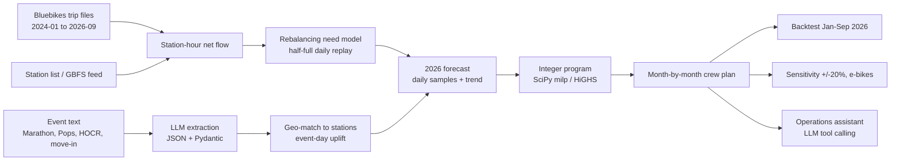

# Rebalancing Bluebikes Across Greater Boston: Event-Aware 2026 Crew Planner

IE 5374 Applied Generative AI, Module 7 Hackathon (Topic 1)

A GenAI planning application that decides how many full-time and seasonal rebalancing crews each city (Boston, Cambridge, Somerville, Brookline, other cities) needs in each month of 2026. It uses real Bluebikes trip data, extracts event information with an LLM, and includes an operations assistant that answers questions by calling the model as a tool.

## Results at a glance
- The optimized plan costs **$817k** in expected total cost for 2026, compared with **$1.06M** for keeping January crew levels all year (**23% saving**).
- In the backtest on real Jan–Sep 2026 trips, the plan still comes out about **$84k** ahead of the status quo. The biggest shortfalls are in Boston and Cambridge in summer.
- Sensitivity: the plan is most exposed to +20% ridership, which raises lost revenue by about 70%.

## Architecture



**GenAI techniques used:** API calls with prompt engineering, structured output (JSON validated with Pydantic), and an agent that uses tool calling (`get_plan`, `what_if`, `risky_stations`, `list_events`).

## Setup
1. Open `bluebikes_rebalancing_final.ipynb` in Google Colab or Jupyter.
2. Install dependencies:
   ```
   pip install pandas numpy scipy requests pyarrow matplotlib openai pydantic
   ```
3. Add your OpenAI key, either as a Colab Secret named `OPENAI_API_KEY` or as an environment variable with the same name.
4. Run all cells. The first run downloads about 33 monthly trip files from the Bluebikes S3 bucket and caches the aggregates in `data/`. Later runs are fast.

## Repository contents
| File | Purpose |
|---|---|
| `bluebikes_rebalancing_final.ipynb` | Full pipeline, with all outputs and the analysis report (Section 10) |
| `README.md` | This file |

## Key assumptions
- The crew costs, capacity and rules come from the brief.
- Each station starts the day half full.
- One unmoved bike means one failed trip, with an expected loss of $5.70.
- 1% of an event crowd rides Bluebikes.
- E-bike trips create 30% more imbalance in the e-bike scenario.

Section 10 of the notebook has the full details.

## Data sources
- Bluebikes trip histories: https://s3.amazonaws.com/hubway-data/index.html
- Bluebikes station list and GBFS feed: https://bluebikes.com/system-data
- Both are used under the Bluebikes Data License Agreement.
- Event sources: *(add the official pages used)*

## Team contributions
| Member | Contributions |
|---|---|
| Aishwarya Vedaraman | *(e.g. data pipeline, imbalance model, staffing optimization, report)* |
| Varalakshmi | *(fill in)* |
| Colin | *(fill in)* |

## AI use
We used an AI assistant (Claude) to draft parts of the code and the report. The team reviewed, ran and edited everything. AI-assisted sections are marked `AI-assisted` in the notebook.
